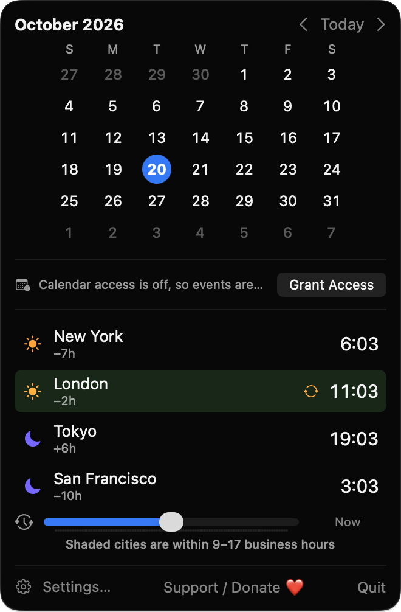
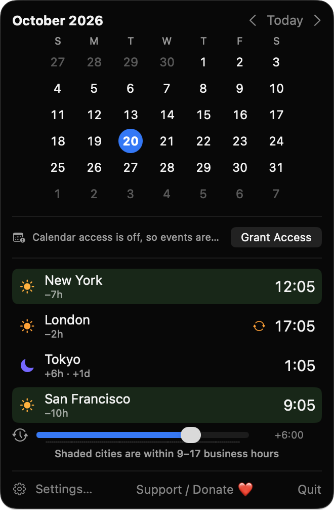
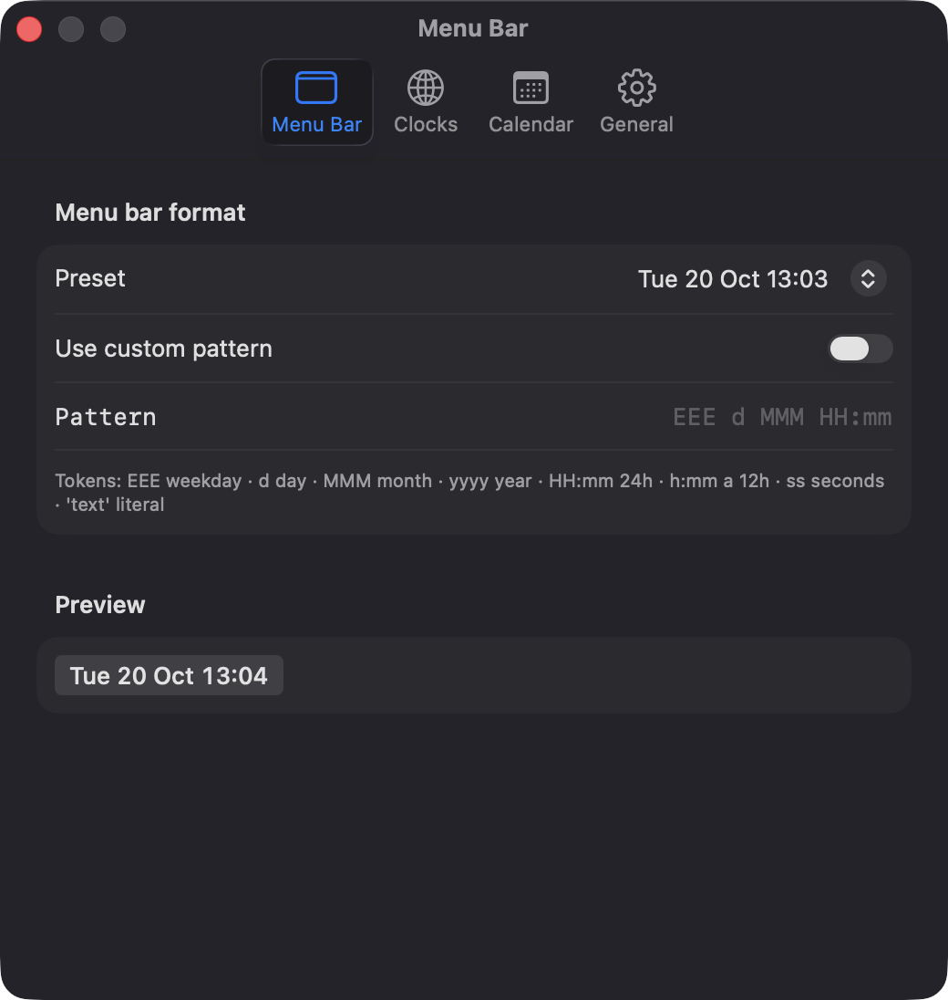
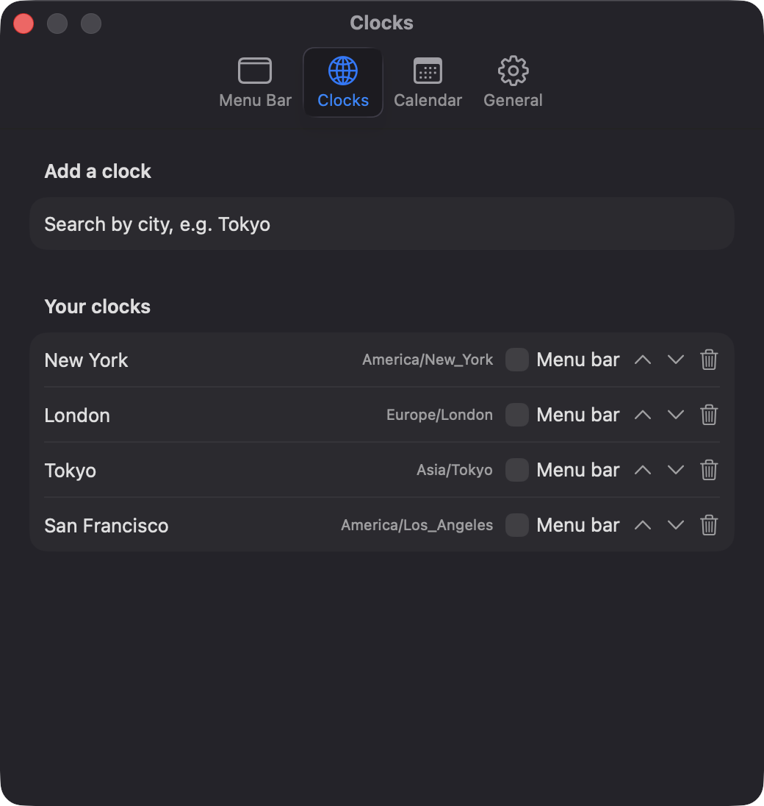

# ZoneClockBar

**🌐 Website:** [turhe123.github.io/zone-clock-bar](https://turhe123.github.io/zone-clock-bar/)

A menu bar calendar with world clocks, upcoming events and a time-zone slider for planning calls across cities.


## Why

ZoneClockBar is a free, open-source, 100% native, backend-free alternative to paid utilities in the *Timers & Reminders* category. It was inspired by the idea behind Dato ($18 one-time): a menu bar clock that opens into a calendar, your upcoming events and the time in the cities you work with. ZoneClockBar keeps that core and adds a simple meeting-planner slider.

## Features

- **Configurable menu bar text**: pick from 7 presets (e.g. `Tue 20 Oct 14:05`) or write a custom `DateFormatter` pattern. An invalid pattern falls back to the default and shows a red hint. A live preview is in Settings.
- **Pinned clocks in the menu bar**: any city can also be shown next to the date. Long titles are truncated to 48 characters.
- **Month calendar popover**: today is highlighted, with optional week numbers, a configurable first weekday and previous/next/Today buttons.
- **Keyboard shortcuts**: arrow keys change month, `T` returns to today.
- **Upcoming events**: events from your calendars for the next 1–14 days (default 3), grouped by day, with calendar colors. All-day and multi-day events are handled. You can choose which calendars to include. The list updates when the calendar store changes.
- **World clocks**: add cities by searching time-zone identifiers, rename them, reorder them, remove them. Each row shows local time, offset from your zone, day offset (`+1d`) and a sun or moon symbol.
- **Time-travel slider**: drag ±12 hours in 15-minute steps and every city updates together. Cities within 9–17 business hours are shaded.
- **Daylight saving indicator** when a city shifts within the next seven days.
- **Click to copy**: clicking a city copies its time as text.
- **Stays accurate**: refreshes on the minute (or second, if your format shows seconds), after wake from sleep, and when the system clock or time zone changes.
- **Launch at login** via `SMAppService`.
- Works without calendar access: clocks and the calendar grid keep working, and the event area shows a note with a button to grant access.

## Screenshots

<p align="center"></p>

<p align="center"><em>Click the menu bar clock to open a month calendar with today highlighted and live world clocks for every city you work with.</em></p>

<p align="center"></p>

<p align="center"><em>Drag the time-travel slider to shift every city together and see who is inside business hours, with day offsets like +1d.</em></p>

<p align="center"></p>

<p align="center"><em>Choose a menu bar date format from presets or a custom pattern, with a live preview.</em></p>

<p align="center"></p>

<p align="center"><em>Search for cities to add, rename and reorder clocks, and pin any of them to the menu bar.</em></p>

## Install

1. Download `ZoneClockBar-macOS.zip` from the [latest release](https://github.com/turhe123/zone-clock-bar/releases/latest).
2. Unzip it and move `ZoneClockBar.app` to `/Applications`.
3. Because the app is open source and not notarized, run:

   ```bash
   xattr -cr /Applications/ZoneClockBar.app
   ```

4. Right-click the app and choose **Open** the first time.

## Build from source

Requires macOS 14+ and Xcode with Swift 5.9+.

```bash
brew install xcodegen
xcodegen generate
xcodebuild -project ZoneClockBar.xcodeproj -scheme ZoneClockBar -configuration Release -derivedDataPath ./build build
```

The app is produced at `build/Build/Products/Release/ZoneClockBar.app`.

## Permissions

- **Calendars (full access)**: the only permission the app requests. It is used to read your events and show them under the calendar grid. It is read-only, and you can deny it; everything else still works. You can change it later in System Settings → Privacy & Security → Calendars.
- **Login item**: only if you turn on "Launch at login" in Settings.

The app does not request Accessibility, Screen Recording, Microphone or any other permission, and makes no network connections.

## Built with AI

ZoneClockBar was written by [Claude Code](https://claude.com/claude-code) inside an automated pipeline, from a plain-English spec. No code, binaries or assets from any commercial app were used; it is a clean-room reimplementation of a feature set, not a copy.

What that means in practice:

- The full source is in this repo under the MIT license. Read it before you run it.
- No network calls, no analytics, no third-party dependencies. Only Apple frameworks.
- Ad-hoc signed and not notarized, which is why Gatekeeper warns on first launch.
- It has had less human review than a hand-written app. Bug reports and pull requests are welcome.

## Support ❤️

ZoneClockBar is free. If it helps you plan your calls, you can support its development:

[Support Or (Leo) Davidai ❤️ on Ko-fi](https://ko-fi.com/leodavidai)

## License

MIT © Or Davidai Bachar

## More free Mac apps

Prefer something that runs in the browser? The same pipeline builds [free, private web tools](https://turhe123.github.io/web-tools/): PDF, image, developer, data and audio tools, nothing uploaded.
